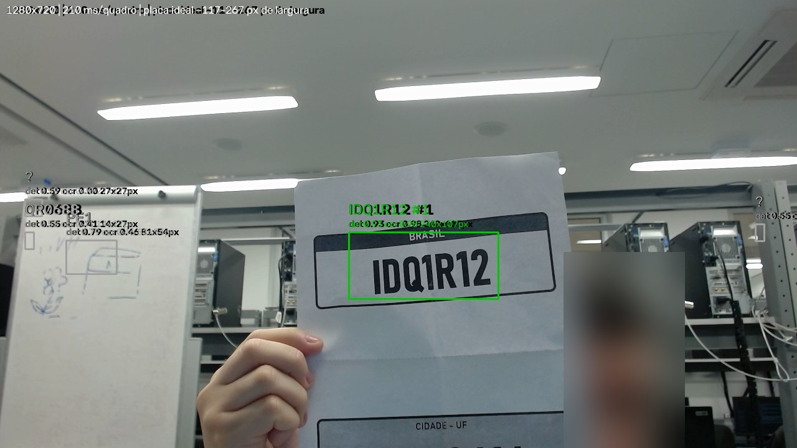

# py_vision_park — microsserviço ALPR

Lê frames de uma câmera USB (ou de um vídeo gravado, para testes), detecta a placa, faz OCR e envia o evento
ao backend (`POST {BACKEND_URL}/eventos-alpr`). Hoje o detector e o OCR são **fakes**
por padrão (`RECOGNITION_MODE=fake`). Com `RECOGNITION_MODE=fpo` (**recomendado**) usa o nosso detector (`models/detector.keras`) + o OCR pronto fast-plate-ocr. Com `RECOGNITION_MODE=tf` usa os modelos Keras próprios de `models/` (treino e avaliação: [docs/senac.md](docs/senac.md)).

## Rodar
```
python -m venv .venv
.venv\Scripts\pip install -r requirements-dev.txt   # TensorFlow só é necessário para treino/modelos reais
copy .env.example .env                              # preencha BACKEND_API_KEY (mínimo 32 caracteres, igual ao ALPR_API_KEY do Back_park)
.venv\Scripts\python iniciar.py
```
Testes: `.venv\Scripts\python -m pytest tests/unit -q`

## Configuração (`.env`)
| Variável | Padrão | Significado |
|---|---|---|
| `CAMERA_SOURCE` | `data/teste.mp4` | índice da webcam USB (ex.: `0`) ou caminho de vídeo para testes |
| `CAMERA_ID` | `portaria-1` | identificador enviado no evento |
| `BACKEND_URL` | `http://localhost:3000` | base do Back_park (sem `/api`) |
| `BACKEND_API_KEY` | vazio | enviada no header `X-API-Key`; obrigatória |
| `MIN_CONFIDENCE` | `0.6` | confiança mínima da detecção (provisório) |
| `DEDUP_SECONDS` | `30` | janela para não repetir a mesma placa (provisório) |
| `SAMPLE_INTERVAL_SECONDS` | `1.0` | intervalo entre frames processados (provisório) |
| `BACKEND_TIMEOUT` | `5` | timeout por requisição, em segundos |
| `BACKEND_MAX_RETRIES` | `3` | tentativas extras após falha (backoff 0.5s, 1s, 2s...) |
| `RECOGNITION_MODE` | `fake` | `fake`, `tf` (modelos Keras próprios) ou `fpo` (detector próprio + fast-plate-ocr, recomendado) |
| `FPO_MODEL` | `cct-s-v2-global-model` | modelo do fast-plate-ocr (nome do hub) **ou** caminho de um `.onnx` próprio (ex.: `models/ocr_fpo_br.onnx`, com `ocr_fpo_br_plate_config.yaml` ao lado), só em `fpo`; falha ao carregar = `/health/ready` 503 |
| `DETECTOR_MODEL_PATH` / `OCR_MODEL_PATH` | `models/detector.keras` / `models/ocr.keras` | usados só em `tf`; modelo ausente = `/health/ready` 503 |
| `DETECTOR_THRESHOLD` | `0.5` | limiar do mapa de probabilidade do detector |
| `OCR_MIN_CONFIDENCE` | vazio | se vazio, usa `MIN_CONFIDENCE` também no OCR. Em `fpo`, use **`0.97`** (medido na webcam em 18/11/2026; ver "Teste manual com webcam") |
| `VOTE_MAX_READS` | `3` | votação: envia o veículo depois de N leituras dele (provisório) |
| `VOTE_GAP_FRAMES` | `3` | votação: ou depois de N quadros amostrados sem vê-lo (com 1 quadro/s, ~3 s; provisório) |

## OCR fast-plate-ocr (modo `fpo`)
- Pacote `fast-plate-ocr[onnx]==1.1.0` (licença **MIT**), inferência ONNX Runtime em CPU. O detector continua sendo o nosso.
- Medido no teste do RodoSol (4000 imagens): **78,9% de placa inteira ponta a ponta** (nosso OCR: 25,4%). *Teste RodoSol; pode ser otimista porque não se sabe se o RodoSol estava no treino do modelo.* Confiança = média das probabilidades dos caracteres reais (sem padding). Detalhes e curva por limiar: `models/avaliacao_fpo_integrado.json` (gerado por `experiments/avaliar_fpo.py`).
- **Pesos offline:** na 1ª execução o pacote baixa o modelo (precisa de internet) para `~/.cache/fast-plate-ocr/<modelo>/` (Windows: pasta `.cache/fast-plate-ocr` dentro do perfil do usuário; contém um `.onnx` e um `_plate_config.yaml`). Para subir sem internet: rode uma vez com internet (por exemplo `.venv\Scripts\python -c "from app.recognition.fpo_reader import FastPlateReader as R; R.from_model('cct-s-v2-global-model')"`) e copie essa pasta para o mesmo caminho na máquina de destino. Sem cache e sem internet, o serviço sobe com `/health/ready` 503.
- **Modelo ajustado no RodoSol** (`models/ocr_fpo_br.onnx`, fora do git): **94,0%** ponta a ponta no mesmo teste (original 79,7% com o detector atual; motos de 58-77% para 95%). Usar com `FPO_MODEL=models/ocr_fpo_br.onnx`. **Ainda não é o padrão**: falta comparar os dois em placas reais fora do RodoSol (ver `contexto_projeto.md`, seções 20 e 21). Na webcam com placas impressas (18/11/2026) ele leu as 4 placas do gabarito; resultado na seção abaixo.
- **Limiar do OCR (`OCR_MIN_CONFIDENCE`): 0.97.** No RodoSol, 0.97 cobre 92,8% com 99,4% de precisão (0.95: 94,5% / 98,8%). Na webcam, 0.95 deixou passar 2% de leituras erradas e 0.97 nenhuma. Ainda deve ser conferido com placas reais.

## Ajuste fino do OCR (GPU NVIDIA, Windows nativo, sem WSL2)
O treino do fast-plate-ocr roda no backend **PyTorch** do Keras 3, que usa a GPU no Windows. O TensorFlow (CPU) só exporta o ONNX.
```
# 1) ambiente de treino, fora do repo (uma vez)
uv venv --python 3.11 %USERPROFILE%\.venvs\alpr-train
uv pip install --python %USERPROFILE%\.venvs\alpr-train torch --torch-backend=cu128
uv pip install --python %USERPROFILE%\.venvs\alpr-train "fast-plate-ocr[train,onnx]==1.1.0"
# 2) dados: recortes do RodoSol (data/rodosol) no formato do fast-plate-ocr
.venv\Scripts\python -m training.exportar_fpo --regiao Brazil
# 3) pesos de partida em models/fpo_base/: cct_s_v2_global.keras + _model_config.yaml + _plate_config.yaml
#    (release "arg-plates" de github.com/ankandrew/fast-plate-ocr)
# 4) treinar (dentro de data/fpo)
set KERAS_BACKEND=torch
fast-plate-ocr train --model-config-file ..\..\models\fpo_base\cct_s_v2_global_model_config.yaml --plate-config-file ..\..\models\fpo_base\cct_s_v2_global_plate_config.yaml --annotations train.csv --val-annotations val.csv --weights-path ..\..\models\fpo_base\cct_s_v2_global.keras --lr 0.0001 --epochs 40 --early-stopping-patience 8 --batch-size 64 --workers 8 --seed 42 --output-dir ..\..\models\fpo_br
# 5) exportar e avaliar (exportar_onnx_fpo contorna um PermissionError do exportador no Windows)
set KERAS_BACKEND=tensorflow
%USERPROFILE%\.venvs\alpr-train\Scripts\python -m training.exportar_onnx_fpo --model models\fpo_br\<data>\best.keras --plate-config models\fpo_base\cct_s_v2_global_plate_config.yaml --out models\ocr_fpo_br.onnx
.venv\Scripts\python -m experiments.avaliar_fpo --model models\ocr_fpo_br.onnx --out models\avaliacao_fpo_br.json
```
Cuidados: confira que a 1ª época já começa perto de 85-89% de `val_plate_acc` (se não, os pesos não carregaram: a CLI usa `skip_mismatch=True` e não avisa). Use threads (`--workers 8`), não `--use-multiprocessing`, que no Windows fica ~7x mais lento. Na RTX 3060: ~1,6 min/época com 12 000 imagens.

## Teste manual com webcam e placas impressas (ambiente controlado)
Sem acesso ao estacionamento, o teste com a câmera USB real usa placas **simuladas** impressas em papel.
```
.venv\Scripts\python -m experiments.folha_placas      # gera experiments/folha_placas/folha_placas.pdf + gabarito.csv
.venv\Scripts\python -m experiments.webcam_placas     # webcam 0; opções: 1, --dshow, --largura 1280 --altura 720, --fpo-model models/ocr_fpo_br.onnx
```
Comando usado no PC do Senac (Logitech C920e no índice 0):
```
.venv\Scripts\python.exe -m experiments.webcam_placas 0 --dshow --largura 1280 --altura 720 --fpo-model models/ocr_fpo_br.onnx
```
Sem `--fpo-model`, usa o OCR original (`FPO_MODEL` do `.env`). Em 640x480 a C920e dá ~30 quadros/s; em 1280x720, ~10 (com `--dshow`), mas a placa sai maior.
- **Folha:** A4 dividida na horizontal, uma placa por metade (Mercosul em cima, antiga embaixo), 2 páginas para frente e verso. Imprimir em "tamanho real"/100%. Placa de carro a 47,5% do real (19 x 6,2 cm); fonte Bahnschrift, não a oficial. Texto aleatório fixo pela `--seed`.
- **Janela:** verde = leu igual ao gabarito; vermelho = passou nos limiares, mas errado; cinza = abaixo dos limiares. O topo mostra a faixa de largura ideal da placa em pixels: afaste ou aproxime a folha até entrar nela. `s` salva o quadro; `q`, Esc ou fechar a janela no X sai.
- **Saída:** `experiments/webcam/leituras_<data>.csv` e um resumo no terminal. As duas pastas de saída ficam fora do git.

### Resultado de 18/11/2026 (Senac, webcam Logitech C920e, OCR ajustado `ocr_fpo_br.onnx`)


Folha impressa na mão, luz do laboratório, 1280x720, ~7,5 min (~2 660 quadros, ~210 ms por quadro em CPU).

| Placa | Leituras aceitas | Largura da placa (mín / mediana / máx) |
|---|---|---|
| `JBN0614` (antiga) | 281 | 148 / 267 / 374 px |
| `IDQ1R12` (Mercosul) | 222 | 161 / 240 / 321 px |
| `CKG8N07` (Mercosul) | 108 | 134 / 227 / 307 px |
| `VDF9551` (antiga) | 51 | 147 / 254 / 281 px |

- **Limiar do OCR:** com 0.95, 2% das leituras aceitas estavam erradas (`JBN0611`, `IDQ1R72`...), todas com confiança entre 0,955 e 0,962. Com **0.97**: 603 aceitas, **0 erradas** (perde ~9% das leituras certas, que a votação entre quadros compensa). Por isso o limiar passou a 0.97.
- **Fundo:** o detector marca muitas regiões falsas (computadores, lousa), mas o OCR rejeita todas.
- **Não medido ainda:** distância máxima (nenhuma leitura certa abaixo de ~130 px de largura), contraluz e ângulo. É papel com fonte não oficial, então não vale como número de placa real.
- Precisa do `opencv-python` com janela: se `cv2.imshow` falhar (`GUI: NONE`), o `opencv-python-headless` sobrescreveu o pacote. Rode `.venv\Scripts\python -m pip install --force-reinstall --no-deps opencv-python==5.0.0.93`.

## Health
- `GET /health/live`: o processo está de pé.
- `GET /health/ready`: 200 com contadores (`frames`, `events_sent`, `duplicates`, `send_failures`, `invalid_plates`); 503 se a câmera não abriu ou o worker parou.

## Contrato com o backend
Body JSON camelCase e estrito (campo extra = 400): `eventId`, `cameraId`, `plateText`, `detectionConfidence`, `ocrConfidence`, `capturedAt` (ISO 8601 com offset).
Idempotência por `eventId`: 201 novo, 200 `duplicado:true`, 409 corrida (reenvia).
Reenvia em rede/timeout/409/429/5xx (429 respeita `Retry-After`, teto de 30s); não reenvia em 400/401/503.

Conferido em 23/11/2026 contra a `main` do Back_park (`aed2e5f`): contrato igual; os middlewares novos (helmet, CORS, `originGuard`) não barram o serviço, porque o httpx não manda `Origin`. O limite global de 300 req/15 min por IP vale também para `/eventos-alpr`.

### Backend na Azure (antes de apontar `BACKEND_URL` para lá)
- `ALPR_API_KEY` precisa estar nas **variáveis de ambiente do App Service** (portal da Azure). O secret do GitHub só vale no build/teste do Actions; sem a variável no App Service, `/eventos-alpr` responde 503. `BACKEND_API_KEY` daqui = o mesmo valor.
- Em 23/11/2026 nenhum dos hosts `api-t13-tecinfo`, `api-t13-teste`, `apit13-tecin`, `apit13teste` `.azurewebsites.net` resolvia no DNS (nem pelo 8.8.8.8). Pegar a URL real no portal (pode ter o sufixo único, `<app>-<hash>.<região>-01.azurewebsites.net`).
- Este serviço lê a câmera diretamente: na Azure, `CAMERA_SOURCE` só funciona com um stream acessível pela internet (RTSP/HTTP); webcam USB não. Ainda não há Dockerfile nem deploy deste repositório.

## Políticas
- **Perda de eventos:** se o backend rejeitar ou ficar indisponível após as tentativas, o evento é logado e **descartado**; não há fila nem banco. O worker continua.
- **Uma leitura por veículo (votação):** leituras parecidas (até 2 caracteres diferentes) em quadros seguidos são do mesmo veículo. Ele é enviado **uma vez**, com o texto votado posição a posição (peso = confiança do OCR), depois de `VOTE_MAX_READS` leituras ou de `VOTE_GAP_FRAMES` quadros sem vê-lo. Depois disso, o `DEDUP_SECONDS` impede reenviar o mesmo veículo que reaparece. No fim do vídeo ou na parada da câmera, o que estava em votação é enviado. Código: `app/services/voter.py`.
- **Placa inválida:** só formatos Mercosul (`ABC1D23`) e antigo (`ABC1234`) são enviados. Caracteres ambíguos (O/0, I/1) **não** são corrigidos; leituras fora do formato são descartadas e contadas em `invalid_plates`.
- **Erro de câmera, detector ou OCR:** o worker para e `/health/ready` passa a responder 503.
- **Privacidade:** não se loga frame completo nem placa completa por padrão.
